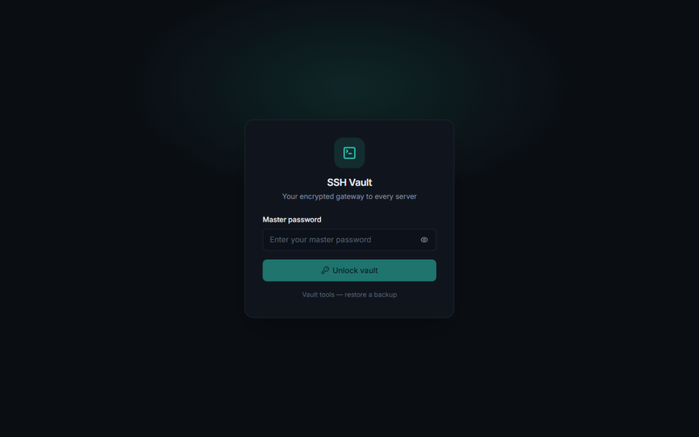
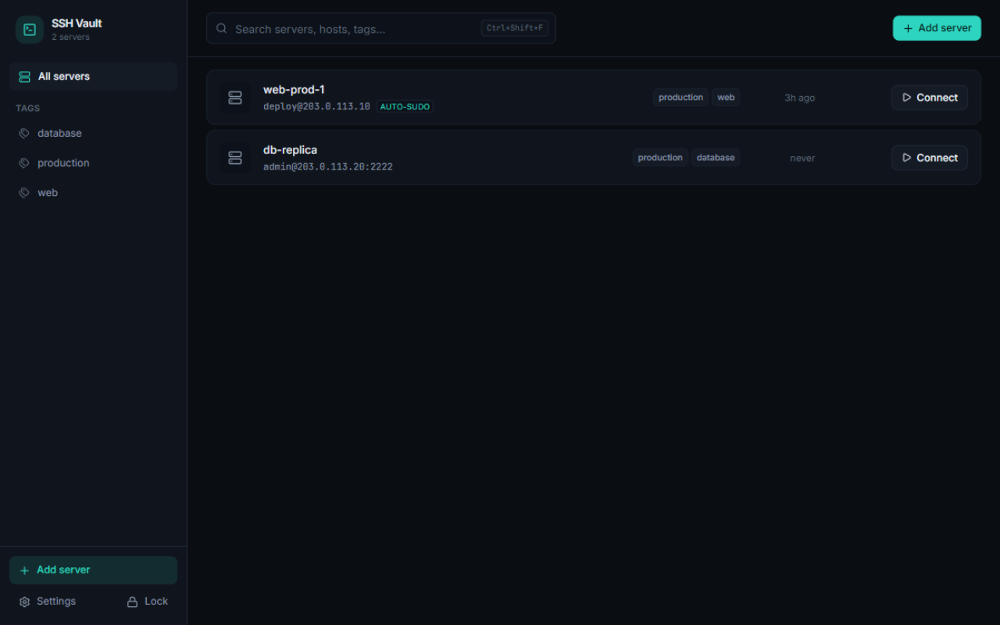

<p align="center">
  
</p>

# SSH Vault

A secure, minimal SSH connection manager for Windows — PuTTY's job, without the dialogs.

One master password unlocks an encrypted vault of servers; a single click opens a real terminal
tab; and with **auto-sudo** you land in a root shell without ever typing `sudo` or its password
again.

| Unlock | Servers |
| :---: | :---: |
|  |  |

## Getting started

**Requirements:** Windows 10/11 x64, Node.js 22+ (to build from source).

Download a prebuilt release (`SSH Vault-x.x.x-setup.exe` installer or the portable exe) from
[Releases](https://github.com/mohammadhosseinjafaripour/SSH-Manager/releases), or build it
yourself:

```bash
git clone https://github.com/mohammadhosseinjafaripour/SSH-Manager.git
cd SSH-Manager
npm install
npm run dev        # development (Electron + hot reload)
npm run verify     # typecheck + unit tests + lint + audit
npm run package    # NSIS installer + portable exe (release/)
npm run smoke      # launch the packaged app and prove it renders
```

There is also a browser-only development mode with a mock SSH backend — handy for working on
the UI without touching real servers:

```bash
npm run dev:ui     # serves the renderer at http://localhost:5188
```

### If downloads stall

On networks that throttle large HTTPS downloads from GitHub/CDNs, `electron-builder` can hang
forever fetching the Electron runtime. A small static mirror works around it — stage the files
with `curl`, serve them locally, and point the builder at that URL:

```bash
node scripts/local-mirror.mjs &     # serves .local-mirror/ on 127.0.0.1:8123
ELECTRON_MIRROR=http://127.0.0.1:8123/mirror/electron/ \
ELECTRON_BUILDER_BINARIES_MIRROR=http://127.0.0.1:8123/bins/ \
  npm run package
```

The mirror root layout is `.local-mirror/mirror/electron/v<version>/electron-v<version>-win32-x64.zip`
and `.local-mirror/bins/` for the NSIS/winCodeSign archives. `.local-mirror/` is git-ignored.


## Features (MVP)

- **Master-password vault** — Argon2id + AES-256-GCM encrypted file at
  `%LOCALAPPDATA%\SSHVault\vault.bin`. Zero-knowledge: a forgotten master password means the
  vault cannot be recovered (stated at setup).
- **Servers, one click away** — named entries with host, port, username, tags and notes;
  add/edit/delete (delete requires typing the server name); instant search (`Ctrl+Shift+F`).
- **Tabbed terminals** — xterm.js with 256-color support, copy-on-select, right-click paste,
  reconnect, per-tab status (connecting / connected / **ROOT** / failed).
- **Auto-sudo elevation** — per server: `sudo -s`, `sudo -i`, `sudo su -` or a custom sudo
  command; the sudo password defaults to the login password (a separate one can be stored).
- **Host-key protection (TOFU)** — the SHA256 fingerprint is pinned on first connect and shown
  for approval; any later change hard-refuses the connection and offers a side-by-side
  comparison with a typed-confirmation replacement flow.
- **Auto-lock** — after a configurable idle time the vault re-locks; running sessions stay
  alive, reconnecting requires the master password. `Ctrl+Shift+L` locks immediately.
- **Keyboard-interactive auth** — hidden `Password:` prompts are auto-answered; OTP/2FA
  challenges appear in a dialog honoring each prompt's echo flag.
- **SSH key authentication** — password, private key (PEM/OpenSSH, optional passphrase),
  or your system SSH agent. Keys are pasted, loaded from a file, and stored encrypted in
  the vault; they never leave the main process.
- **Terminal search** — `Ctrl+Shift+F` (or the magnifier in the tab bar) searches the full
  scrollback with match-case and whole-word toggles and a live match counter.
- **Bulk health check** — **Check all** probes every server in parallel (8 at a time) and
  shows a latency pill per row (`18ms`), `auth failed`, `down`, or `key changed`.
- **Upload conflict handling** — choose *overwrite*, *keep both* (auto-renames), or *skip*,
  both in the toolbar and in a prompt when a drop collides with existing files.
- **Rename & chmod** — rename files and folders from the Files panel and edit permissions
  with an owner/group/other checkbox grid (with the octal shown live).
- **Inline command suggestions (ghost text)** — as you type, a dimmed completion appears
  after the cursor, Copilot-style. **Tab** accepts it, **Right-arrow** accepts one path
  segment, **Esc** dismisses. Suggestions come from three local sources, in order: your own
  command history on that server, a built-in catalog of ~120 commands with their common
  flags and subcommands (`git`, `docker`, `systemctl`, …), and real remote file paths listed
  over SFTP. Typical completions:

  | You type | Ghost | Why |
  | --- | --- | --- |
  | `clea` | `r` | catalog command |
  | `ls -l` | `a` | flag of `ls` |
  | `systemctl re` | `start` | subcommand |
  | `cd lo` | `gs/` | remote directory (SFTP) |
  | `tail -f /var/log/ngi` | `nx/error.log` | remote path |

  **Several candidates?** When more than one match exists (e.g. `git ` or `ls -`), the first is
  shown as the ghost with a `1/6` counter — press **↑/↓** to cycle through the alternatives,
  then **Tab** to accept the highlighted one.

  **It is entirely local — no AI, no API key, no network calls.** Nothing about your
  commands, servers or files leaves the machine. The only remote request is an SFTP
  directory listing when a path completion is needed, which goes to the server you are
  already connected to. Toggle it in **Settings → Connection**.

- **Sessions that survive being away** — SSH keepalives plus a `TMOUT` reset keep idle
  sessions alive through NAT/firewall timeouts, and if a link really dies the session
  **reconnects automatically** with exponential backoff (1s → 30s, forever) while keeping
  the tab and all previous output on screen.
- **File transfer (SFTP)** — the **Files** button next to your tabs opens a remote file
  browser: drag & drop files *or whole folders* onto the panel (or the terminal), download
  the other way, create folders, and delete. Transfers show live progress, run over their
  own SSH connection so they never slow down your shell, and stay inside the same
  host-key verification as the terminal. See [File transfer](#file-transfer-sftp).
- **Clipboard done properly** — `Ctrl+Shift+C` copies the selection, `Ctrl+Shift+V` pastes
  (with bracketed paste so multi-line commands don't fire line by line), `Ctrl+Insert` /
  `Shift+Insert` also work, and right-click copies when there's a selection or pastes when
  there isn't. Plain `Ctrl+C` still sends SIGINT to the remote shell.
- Dark/light/system themes, durable vault writes with two backup generations.
- **Batch import / export** — move every server to a new machine in two clicks
  (see below).

## Moving to a new machine (import / export)

Settings → **Move your servers**:

- **Encrypted export** creates a `.sshvault` file containing all servers — passwords
  included — sealed with Argon2id + AES-256-GCM under a password you choose for the
  file. It is safe to carry on a USB stick or through cloud storage; without the
  password it is indistinguishable from random bytes. Pinned host keys can ride
  along too, so the new machine skips first-connect fingerprint prompts.
- **Import file…** accepts that `.sshvault` file (it asks for the file's password)
  or a plain CSV. Import runs in one of two modes:
  - *Merge (recommended)* — adds everything new; servers that already exist
    (same name + host + port + username) are skipped and reported.
  - *Replace everything* — wipes the current servers and pins, then loads the
    file (requires an explicit confirmation).
- **Export as CSV** writes a plaintext spreadsheet (`name,host,port,username,password,
  tags,notes,auto_sudo,sudo_command`; tags are `;`-separated inside their cell).
  Useful for bulk-editing or moving to another tool — and deliberately gated
  behind an "I understand the risk" checkbox, because the passwords are readable
  by anyone who opens the file. The same CSV format can be imported back.

Typical migration: on the old machine → *Encrypted export*; on the new machine →
create a vault, *Import file…*, enter the export password, Merge. Done.

## File transfer (SFTP)

Open a session, then click **Files** in the tab bar. The panel starts in your home
directory and gives you:

- **Drag & drop** — drop files *or folders* onto the panel (or onto the terminal itself)
  to upload them into the directory you're viewing. Recursive folder upload preserves the
  tree.
- **Upload** — native picker for files and folders.
- **Download** — tick one or more entries and choose a local destination folder; folders
  are downloaded recursively.
- **New folder**, **rename**, **chmod** (permission grid), **delete** (recursive, with
  confirmation), sorting by name/size/date, a mode column (`rw-r--r--`), and a path bar
  you can type into.
- **Readable listing** — the name column keeps a minimum width so long filenames never
  collapse into an ellipsis; **Mode / Size / Modified** can each be shown, hidden and
  resized. Drag a column edge in the header to resize it (double-click resets it), use the
  column button at the right of the header to toggle columns, and drag the divider between
  the terminal and the panel to make the whole panel wider. Both layouts are remembered.
- **Conflict handling** — pick overwrite / keep both / skip in the toolbar, or answer a
  prompt when a drop collides with files that already exist.

Transfers stream in 32 KB chunks with 16-way concurrency and report live progress, so
multi-GB uploads don't exhaust memory. A separate SSH connection is opened for SFTP, so a
large transfer never competes with your interactive shell for window space. The host key
is checked against the same pin as the terminal, and a **changed** key is refused.

## System tray

Closing the window while sessions are connected does **not** exit the app — it hides to
the system tray and your connections keep running. A balloon explains it the first time;
the tray tooltip shows the live-session count.

- Click the tray icon (or **Show SSH Vault** in its menu) to reopen the window
- **Quit (closes all sessions)** ends every connection and exits the app
- Closing the window with **nothing** connected exits normally, as expected
## Updates

SSH Vault updates itself from GitHub Releases — no links in chat, no manual
re-downloads.

- **Automatic checks** run shortly after launch and every six hours. They can be
  turned off in **Settings → Updates**; when off, the app makes no request at all.
- When a newer version exists it **downloads in the background** and the Settings
  panel shows progress, then offers **Restart and install**.
- Installing is **always your decision** — the app never quits on its own, because
  that would kill live SSH sessions. `autoInstallOnQuit` is deliberately disabled.
- **Check now** always works, even with automatic checks disabled, and there is a
  **Release notes** button that opens the GitHub releases page.

Privacy: a check is one HTTPS GET for a public `latest.yml` manifest. It sends
nothing about you, your servers or your usage. The downloaded installer is
verified against the `sha512` published in that manifest.

The **portable** build cannot self-update (there is no installation to replace);
it reports the new version and links to the release page.

To publish a new version, see [docs/RELEASING.md](docs/RELEASING.md): bump the
version, run `npm run package`, and attach the installer, `latest.yml` and the
`.blockmap` to a tagged GitHub Release.

## Staying connected

Servers that drop you after a few idle minutes are handled in three layers:

1. **SSH keepalives** every 15s, tolerating 20 missed replies (≈5 minutes) — keeps NAT and
   firewall state alive, and survives short laptop sleeps or VPN blips.
2. **`TMOUT=0`** is sent right after login, which defeats the common
   `/etc/profile`-style idle logout and `bash`'s `TMOUT`.
3. **Auto-reconnect** — if the connection still dies, the tab reconnects with backoff
   (1s, 2s, 5s, 10s, 20s, then every 30s, indefinitely) and keeps all previous output. Root
   elevation is re-established automatically.

Both keepalives and auto-reconnect can be turned off in **Settings → Connection**. Sessions
you close yourself never reconnect, and a rejected password is never retried (that would
feed account-lockout counters).

## Keyboard shortcuts

Inside the terminal app shortcuts use `Ctrl+Shift+*` so plain `Ctrl+L`, `Ctrl+W`, `Ctrl+N`
always reach your remote shell. Outside the terminal plain `Ctrl+*` also works.

| Action | Shortcut |
| --- | --- |
| Lock vault | `Ctrl+Shift+L` |
| Close tab | `Ctrl+Shift+W` |
| Search | `Ctrl+Shift+F` (plain `Ctrl+F` outside terminal) |
| New server | `Ctrl+Shift+N` (plain `Ctrl+N` outside terminal) |
| Cycle tabs | `Ctrl+Tab` / `Ctrl+Shift+Tab` |
| Copy in terminal | select text (auto-copies), `Ctrl+Shift+C`, or `Ctrl+Insert` |
| Paste in terminal | `Ctrl+Shift+V` or `Shift+Insert`; right-click pastes when nothing is selected |
| Files panel | **Files** button in the tab bar |
| Find in terminal | `Ctrl+Shift+F` or the magnifier in the tab bar |
| Accept suggestion | `Tab` (whole) / `Right-arrow` (one segment) / `Esc` dismiss |
| Cycle suggestions | `Up` / `Down` while a ghost is showing |

## Security design

**Threat model — defended against**

- *Vault theft at rest*: the vault file is useless without your master password
  (Argon2id, 64 MiB / 3 passes / 4 lanes, 16-byte salt; AES-256-GCM with the header bound as
  AAD — tampering or a wrong password both fail authentication).
- *Casual shoulder-surfing*: lock screen hides all content; auto-lock after idle; passwords are
  masked in the UI.
- *Host-key MITM on first connect*: you see and approve the fingerprint before any credential
  is sent — host verification happens **before** authentication, so passwords never travel to
  an unverified host.
- *Password exposure during sudo*: elevation sends the password only after detecting sudo's
  unique per-attempt prompt marker, exactly once, with terminal echo disabled — it never
  appears on screen, and is never sent on NOPASSWD servers (no prompt, no send, ever).
  The sudo secret travels only inside the encrypted SSH channel.
- *Malicious web content*: the renderer is sandboxed with `contextIsolation`, no Node access,
  a strict CSP, no remote content, and a single-instance lock. Packaged builds flip Electron
  fuses (no `runAsNode`, no inspect, ASAR-only with embedded integrity).

**Explicitly out of scope**: malware already running as your Windows user can read keystrokes
and memory of any application, including this one. No local tool can defend against that.

**Update policy**: no auto-update (supply-chain risk); check releases manually and verify the
download. Production dependency audit: `npm audit --omit=dev` is clean at release.

## Auto-sudo: how it stays safe

```
stty -echo; sudo -S -k -v -p '[SSHVAULT:<nonce>]' && stty echo && sudo -s; stty echo
```

Two phases, because `sudo -s` runs a shell *inside* sudo:

1. `sudo -v` validates the password and caches a ticket (prompt → stderr → PTY).
2. On success, `stty echo` restores echo **in your own shell**, then the root shell starts
   with the cached ticket — so echo is on for the whole session.

- `-k` makes the prompt deterministic (kills cached sudo tickets)
- the per-attempt `nonce` prevents false matches on banners/MOTD; the detector ignores the
  marker when it appears quoted (the terminal's echo of the command itself)
- the password is written **only** on an exact match of the bare marker — once, never on
  timeout, never retried, never speculatively
- no timed writes anywhere: a timed `stty echo` could be eaten by sudo as a second password
  attempt and lock the account on slow-auth servers
- if sudo rejects the password and waits for another attempt, the app sends Ctrl+C and
  restores echo, so the terminal is never left accepting invisible input
- NOPASSWD servers (no prompt) and missing sudo are detected and reported — nothing is ever
  written into the live shell

This behavior is pinned by unit tests in `tests/elevate.test.ts`.

## Vault tools & backups

Every save writes: temp file → fsync → copy previous good file to `.bak` (rotating `.bak2`)
→ atomic replace. `Unlock → "Vault tools — restore a backup"` verifies a backup with your
master password and restores it; the displaced file is kept as `vault.bin.corrupt-<ts>`.

## Known limitations (MVP)

- No code signing yet — Windows SmartScreen will warn on first run
  ("More info → Run anyway").
- Password authentication only; SSH keys/agent, SFTP and port forwarding are on the v2 list.
- Automated E2E tests are not included; the security-critical modules (vault crypto, elevation
  detector, host-key verifier, schemas) are covered by 43 unit tests.

## License

MIT
